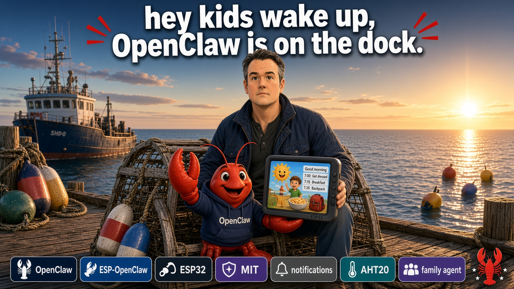
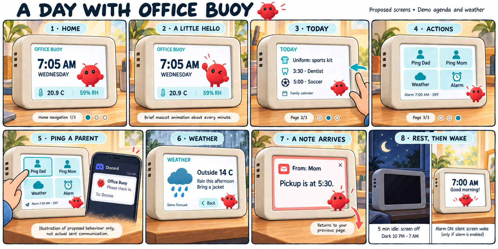
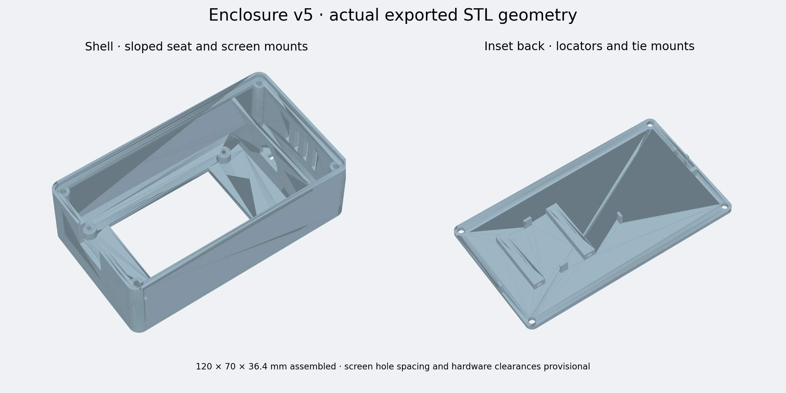

# 🦞 Claw Buoy

**Your OpenClaw agent, out of the chat window and onto your desk.**

A small ESP32 desk companion with a 2.8-inch touchscreen, a claw mascot, room temperature/humidity, a clock, weather, notifications, and local alarm/ping controls. It connects to [OpenClaw](https://github.com/openclaw/openclaw) using [ESP OpenClaw Node](https://github.com/openclaw/esp-openclaw-node).



*Generated hero illustration featuring the project creator; concept hardware and screen, not a product photograph. Badge artwork does not override component licenses.*



*Generated concept storyboard with demo content, not screenshots of V8. See [artwork notes](assets/README.md).*

## Quick start

1. **Get the parts:** see the [parts list](hardware/PARTS.md) (classic Freenove ESP32-WROOM board, 2.8-inch ILI9341/XPT2046 touch display, AHT20 sensor, USB cable and supply, jumper wires).
2. **Wire it** using the [GPIO table](#hardware-and-wiring). Power off first, and note that display LED control is GPIO17, not GPIO16.
3. **Build** with ESP-IDF 5.4.2 for target `esp32`; the commands are in [Build from source](#build-from-source).
4. **Flash** over USB with the same `idf.py` command, after checking wiring and selecting the correct serial device.
5. **Pair** with your OpenClaw gateway: provision Wi-Fi and pairing at runtime from the device REPL, following the upstream [example documentation](https://github.com/openclaw/esp-openclaw-node/tree/main/examples/esp32-node). No credentials go in source.

Optional: print the [V5 enclosure](hardware/enclosure/v5/); read its audit first, since fit is unconfirmed.

## What is included

- [Parts list / BOM](hardware/PARTS.md) and the GPIO wiring table below.
- [V5 enclosure](hardware/enclosure/v5/): body/back STL files, parametric OpenSCAD/Python source, preview and geometry audit. **Dimensions and fit are unconfirmed: the enclosure has not been test-fit.**
- V8 firmware source, mascot assets, portable build configuration, host tests and CI.
- Hero, comic storyboard and selected concept renders; not measured hardware photographs.
- [OpenClaw integration and upstream change inventory](docs/openclaw-integration.md).



Artwork provenance and redistribution scope are documented in [artwork notes](assets/README.md).

## Project status

This is a working hardware prototype, not a finished appliance.

- **V7 firmware** was deployed and checked on the author's unit: gateway reconnection, sensor reads, UI commands, five-minute idle sleep, and physically confirmed backlight-off. Touch wake works but needs tuning; it sometimes took several taps.
- **V8 baseline** is built, USB-flashed and regression-checked (host tests plus deployed checks of sensors, UI state, offline/stale content and notifications). Actual LCD appearance, touch feel and V8 idle/wake have not been physically verified.
- **Enclosure** dimensions and print fit are unconfirmed; it has not been test-fit.

### V9 upstream and touch update

- Node/provisioning sources refreshed through upstream `fb7bbc3`; retains the WROOM/no-PSRAM configuration and local handshake memory patch.
- Custom XPT2046 acquisition retained: named pressure threshold **50**, median filtering, **10 ms** sampling and **1 MHz** SPI. A 2 MHz clock is not enabled without signal verification.
- Main action/alarm buttons activate once on **press-down**. A drag starting on a button therefore activates that button; releasing or dragging afterward cannot undo an action. Page swipes, content navigation and calibration remain release-classified. Main targets are at least 44 px high.
- Sleep wakes on initial contact with a visible halo/backlight receipt; its release does not send a ping or navigate. Tap again to choose a control.
- New calibrations use **three-point affine** fitting, persisted to NVS. Existing two-point calibration remains valid. Legacy `calibrationCorners: [x0,y0,x1,y1]` updates deliberately select legacy mapping.
- Touch self-test: `display.update {"touchTest":true}` shows raw X/Y, pressure, mapped position and a contact dot, with actions suppressed. Exit with `{"touchTest":false}`. Calibration starts with `{"calibrate":true}` and disables pings until restored deliberately.
- Automated checks do not establish physical sensitivity, edge accuracy, LCD appearance or subjective responsiveness. See [touch evaluation](docs/touch-v9.md).

## Hardware and wiring

> **Affiliate disclosure:** As an Amazon Associate I earn from qualifying purchases. Part links below go to amazon.ca and amazon.com search pages and carry an affiliate tag for each store; they do not pin an exact SKU, so check each listing against the specs.

- Freenove classic ESP32-WROOM board ([Amazon.ca](https://www.amazon.ca/s?k=Freenove+ESP32+WROOM+board&tag=threelayerbra-20) / [Amazon.com](https://www.amazon.com/s?k=Freenove+ESP32+WROOM+board&tag=threelayerb0f-20)), no PSRAM, 4 MB flash. Confirm your exact board variant; **GPIO16 is reserved for this board's onboard RGB LED**.
- 2.8-inch ILI9341 SPI TFT ([Amazon.ca](https://www.amazon.ca/s?k=2.8+inch+ILI9341+SPI+TFT+touch+display+XPT2046&tag=threelayerbra-20) / [Amazon.com](https://www.amazon.com/s?k=2.8+inch+ILI9341+SPI+TFT+touch+display+XPT2046&tag=threelayerb0f-20)) (320 × 240 landscape) with XPT2046 resistive touch and onboard backlight-switch circuitry.
- AHT20 temperature/humidity breakout ([Amazon.ca](https://www.amazon.ca/s?k=AHT20+temperature+humidity+sensor+breakout+I2C&tag=threelayerbra-20) / [Amazon.com](https://www.amazon.com/s?k=AHT20+temperature+humidity+sensor+breakout+I2C&tag=threelayerb0f-20)), I²C address `0x38`.
- USB power: cable ([Amazon.ca](https://www.amazon.ca/s?k=USB+data+cable&tag=threelayerbra-20) / [Amazon.com](https://www.amazon.com/s?k=USB+data+cable&tag=threelayerb0f-20)), supply ([Amazon.ca](https://www.amazon.ca/s?k=5V+USB+power+adapter&tag=threelayerbra-20) / [Amazon.com](https://www.amazon.com/s?k=5V+USB+power+adapter&tag=threelayerb0f-20)).
- Jumper wires ([Amazon.ca](https://www.amazon.ca/s?k=dupont+jumper+wires+female+to+female&tag=threelayerbra-20) / [Amazon.com](https://www.amazon.com/s?k=dupont+jumper+wires+female+to+female&tag=threelayerb0f-20)) and a common ground.

These are **GPIO numbers**, not physical header positions. The authoritative definitions are in [`claw_box_display.h`](firmware/esp-openclaw-node/examples/esp32-node/main/claw_box_display.h).

| Signal | ESP32 GPIO | Notes |
| --- | --- | --- |
| TFT SCK | 18 | TFT SPI clock |
| TFT SDI / MOSI | 23 | TFT data |
| TFT SDO / MISO | 19 | Shared return line; see note below |
| TFT CS | 27 | |
| TFT DC / RS | 26 | |
| TFT RESET | 25 | |
| Touch T_CLK | 14 | **Not** the TFT clock |
| Touch T_DIN | 13 | **Not** the TFT MOSI |
| Touch T_DO | 19 | Shared return line |
| Touch T_CS | 33 | |
| Touch T_IRQ | 32 | |
| Display LED control | **17** | PWM backlight; not GPIO16 |
| AHT20 SDA / SCL | 21 / 22 | |
| TFT VCC | 3.3 V | Do not confuse VCC with LED control |
| Ground | GND | Common ground |

Power off before changing wires. GPIO17 controls the **LED input of the verified onboard backlight circuit**, not a bare LED load. Other display modules may need a transistor/driver. On this unit only the ESP32 end of the LED wire moved from 3.3 V to GPIO17; the display end stayed on `LED`.

TFT and touch use separate clocks/data-out but share GPIO19 for return data. Check that your module releases MISO when deselected; a module that does not may require disconnecting TFT SDO (display reads are not used). The legacy Arduino display sketch has a different DC/RESET assignment; it is not the wiring reference for this application.

## Build from source

Use **ESP-IDF 5.4.2**, target `esp32`, and the checked-in defaults. Runtime Wi-Fi provisioning and gateway pairing keep credentials out of source.

```bash
. "$IDF_PATH/export.sh"
cd firmware/esp-openclaw-node/examples/esp32-node
idf.py -B build-claw-box -D SDKCONFIG=sdkconfig.claw-box \
  -D 'SDKCONFIG_DEFAULTS=sdkconfig.defaults;sdkconfig.claw-box.defaults' build
# Only after checking wiring and selecting the correct serial device:
idf.py -B build-claw-box -p /dev/ttyUSB0 flash monitor
```

The repository includes `dependencies.lock`; it records the resolved component versions. Managed components are fetched from Espressif's registry, not committed. Build success is not physical verification. For provisioning and node protocol details, refer to the upstream [example documentation](https://github.com/openclaw/esp-openclaw-node/tree/main/examples/esp32-node); board-specific wiring above overrides generic examples.

### Site-specific actions

The checked-in defaults contain no personal delivery targets or calendar rules. Ping test mode is enabled by default; real delivery requires deliberate local setup. To customize, create an untracked `private_buoy_config.h` beside the example's `CMakeLists.txt`; override the `BUOY_*` strings documented in [`buoy_site_config.h`](firmware/esp-openclaw-node/examples/esp32-node/main/buoy_site_config.h). Keep that file private. Configure your weather location/timezone and authorized calendar in the gateway agent, and explicitly configure any delivery target before enabling real pings. Never publish your locally built image: those overrides become embedded in it.

### Local clock and controls

Override `BUOY_TIMEZONE` (POSIX TZ format), `BUOY_DARK_START_HOUR`,
`BUOY_DARK_END_HOUR`, `BUOY_PING_ONE_LABEL`, `BUOY_PING_TWO_LABEL` and
`BUOY_ACTION_SESSION_KEY` in the ignored `private_buoy_config.h`. The default
clock is UTC; dark hours are 22:00–07:00 local time (equal endpoints disable
scheduled dimming). Halifax uses `"AST4ADT,M3.2.0,M11.1.0"`. Weather/agenda
timezone configuration in the Gateway must agree with the device clock.

### Hardware verification scope

The GPIO table records the working prototype wiring: live AHT20 reads were
verified on GPIO21/22; display/touch operation was checked, and moving only the
ESP32 end of the display LED-control wire to GPIO17 produced physical darkness.
GPIO16 remains reserved for the documented Freenove board. This does not
validate other board variants, bare LED loads, enclosure dimensions or print fit.

Run the hardware-independent regression checks with:

```bash
python3 tools/public_checks.py
```

CI runs those checks, a redacted Gitleaks history scan, and a clean ESP-IDF build. It does not flash hardware or contact a personal gateway.

## Enclosure

[`hardware/enclosure/v5/`](hardware/enclosure/v5/) contains matching `body.stl` / `back.stl`, parametric source, and an [audit](hardware/enclosure/v5/AUDIT.md). Nominal assembled size is 120 × 70 × 36.4 mm. Start with a known PLA profile, 0.2 mm layers, 0.4 mm nozzle, at least three walls, and 4–5 top/bottom layers. These are starting points, not a validated printer job.

The geometry was checked, but the enclosure has **not** been slice-verified or physically test-fit. Read the audit for board envelopes, screw limits, cable clearance, and print orientation. No G-code is supplied.

To regenerate the STL files and preview from the Python source, see [Regenerating the STL files](hardware/enclosure/v5/AUDIT.md#regenerating-the-stl-files).

## Contributing and security

See [CONTRIBUTING.md](CONTRIBUTING.md) and [SECURITY.md](SECURITY.md). Keep live messages, calendars, credentials, device identities, logs, NVS dumps, and machine-specific configuration out of issues and pull requests.

## License and credits

Project-owned materials use [MIT](LICENSE). The firmware under `firmware/esp-openclaw-node/` is a snapshot of [openclaw/esp-openclaw-node](https://github.com/openclaw/esp-openclaw-node) (upstream commit `9d905d3`) with local modifications. It retains its [Apache-2.0 license](firmware/esp-openclaw-node/LICENSE); see its [SNAPSHOT.md](firmware/esp-openclaw-node/SNAPSHOT.md) and the [change inventory](docs/openclaw-integration.md). The vendored jsmn parser retains its MIT notice. Registry dependencies retain their respective licenses; a source repository is not a license grant for upstream names, logos, or trademarks.

---

*As an Amazon Associate I earn from qualifying purchases. Hardware links in this repository go to amazon.ca and amazon.com and are affiliate links; they cost you nothing extra.*
